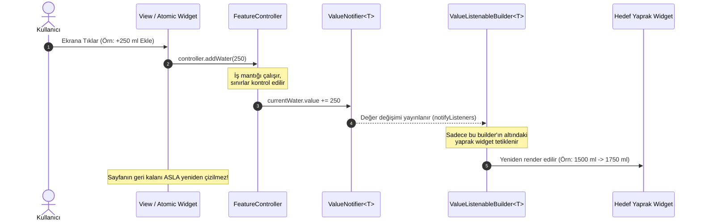
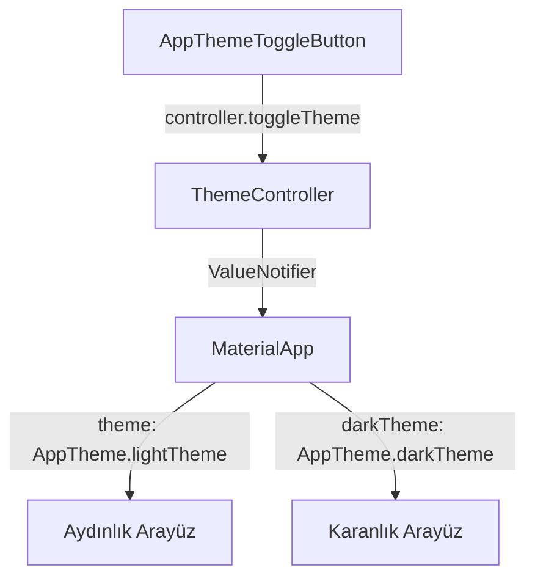

# Susadım Reaktif State ve Veri Akışı Mimarisi (State Flow Reference)

Bu doküman, [project.md](file:///Users/d1-11/Documents/GitHub/SoftIto-MobileEgitim/yuzYuze/19ekim_3/project.md) ve [.agents/skills/SKILL.md](file:///Users/d1-11/Documents/GitHub/SoftIto-MobileEgitim/yuzYuze/19ekim_3/.agents/skills/SKILL.md) standartları uyarınca, **Susadım** uygulamasında kullanılan reaktif durum yönetimi (`ValueNotifier` + `ValueListenableBuilder`) prensiplerini, veri akışını, bileşenler arası sorumluluk sınırlarını ve performans kriterlerini ayrıntılı olarak açıklamaktadır.

---

## 1. Mimari Felsefe ve Neden ValueNotifier?

Susadım mimarisinde harici, ağır ve harici bağımlılık yaratan üçüncü parti paketler (Bloc, MobX vb.) yerine **Flutter'ın yerel çekirdek API'si olan `ValueNotifier` ve `ValueListenableBuilder`** tercih edilmiştir.

### Temel Nedenler ve Kazanımlar:
1. **Sıfır Dış Bağımlılık:** Flutter SDK çekirdeğinde yer alır; sürüm uyumsuzluklarına veya paket eskimesine yol açmaz.
2. **Noktasal Yeniden Çizim (Targeted Rebuild):** Sayfanın tamamı (`Scaffold` veya `Column`) yerine yalnızca değişen yaprak widget (`Text`, `LinearProgressIndicator` vb.) tetiklenir.
3. **Maksimum 60/120 FPS Performansı:** Gereksiz build maliyetleri sıfıra indirilir, pil ve işlemci tüketimi asgariye çekilir.
4. **Saf ve Hızlı Birim Testleri:** Controller sınıfları `BuildContext` veya widget ağacına ihtiyaç duymadan milisaniyeler mertebesinde test edilebilir.

---

## 2. Reaktif Durum Akış Şeması (Mermaid)

Aşağıdaki sıra diyagramı, kullanıcının arayüzle etkileşime girmesinden başlayarak yaprak widget'ın güncellenmesine kadar geçen reaktif akışı göstermektedir:



---

## 3. Katmanlar ve Sorumluluk Dağılımı

Her bir modül (`feature`) `Clean Architecture` ve `Separation of Concerns` prensiplerine göre 4 temel katmana ayrılır:

```
lib/features/<feature_name>/
├── controllers/    # Sadece durum (State) ve iş mantığı (Business Logic)
│   └── <feature>_controller.dart
├── models/         # Değişmez (Immutable) veri modelleri & serileştirme
│   └── <feature>_model.dart
├── view/           # Ekran kompozisyonu (StatelessWidget)
│   └── <feature>_view.dart
└── widgets/        # Parçalı, yeniden kullanılabilir UI bileşenleri (<40 satır)
    ├── <feature>_card.dart
    └── <feature>_action_buttons.dart
```

### 3.1. Controller Katmanı (`controllers/`)
- Durum değişkenlerini `ValueNotifier<T>` türünde tutar.
- Arayüzden tetiklenen metotları (`addWater()`, `reset()`, `toggle()`) barındırır.
- Kesinlikle `BuildContext`, `Widget` veya `setState` barındırmaz.
- Yaşam döngüsü sona erdiğinde bellek sızıntısını önlemek için `dispose()` metodunu sunar.

### 3.2. Model Katmanı (`models/`)
- Tüm alanlar `final` olarak tanımlanır (Immutable yapı).
- `const` yapıcı metoduna sahiptir.
- Durum değişiklikleri doğrudan mutasyon yerine `copyWith()` metodu ile yeni nesne üreterek yapılır.
- `fromJson()` ve `toJson()` ile veri serileştirmesini tam olarak destekler.

### 3.3. Görünüm Katmanı (`view/`)
- Sadece `StatelessWidget` olarak tanımlanır.
- Sayfa düzeyinde ağır `setState` **KESİNLİKLE YASAKTIR**.
- Dinamik parçalar `ValueListenableBuilder` ile sarılır.
- Büyük ağaçları parçalı widget'lara (`widgets/`) delege eder.

### 3.4. Parçalı Widget Katmanı (`widgets/`)
- **40 Satır Kuralı:** `build()` metodunun gövdesi 40 satırı geçemez. Geçiyorsa alt bileşenlere ayrılmalıdır.
- Tüm statik bileşenlerde `const` anahtar kelimesi zorunludur.
- Renkler ve metin stilleri kesinlikle sabit kodlanmaz; `Theme.of(context)` ve `AppColors` üzerinden tüketilir.

---

## 4. Karşılaştırma Tablosu

| Metrik / Yaklaşım | Sayfa Düzeyinde `setState` | Ağır Paketler (Bloc, MobX) | Susadım `ValueNotifier` Standardı |
| :--- | :--- | :--- | :--- |
| **Yeniden Çizim Kapsamı** | Tüm sayfa ağacı (Verimsiz) | Yaprak veya Blok bazlı | **Yalnızca ilgili yaprak widget (En yüksek verim)** |
| **Öğrenme & Kod Karmaşıklığı** | Düşük ancak hata riski yüksek | Çok yüksek (Boilerplate kodlar) | **Düşük, temiz ve standart Dart** |
| **Performans (Frame Drop)** | Sıkça kare atlama riski | Orta - İyi | **Sıfır kare atlama (60/120 FPS)** |
| **Birim Test Kolaylığı** | Zor (Widget tester zorunlu) | Orta (Özel mocklar gerekir) | **Çok Kolay (Doğrudan saf Dart testi)** |
| **Bağımlılık Maliyeti** | Sıfır | Yüksek (Dış paket güncelleme yükü) | **Sıfır (Flutter yerel çekirdek API)** |

---

## 5. Çift Tema (Light/Dark Mode) Durum Entegrasyonu

Susadım uygulaması, Dark Obsidian & Neon Koyu Tema ile Canlı Sportif Aydınlık Temayı dinamik olarak destekler.



### Tema Kullanım Kuralları:
- Bileşen içinde renk ihtiyaçlarında:
  ```dart
  // DOĞRU:
  final colorScheme = Theme.of(context).colorScheme;
  final background = colorScheme.surface;

  // YANLIŞ (Hardcoded):
  final color = Color(0xFF1E1E1E);
  ```

---

## 6. Bellek Yönetimi ve Yaşam Döngüsü (Dispose Protokolü)

`ValueNotifier` dinleyicileri bellek sızıntısına (memory leak) yol açmamak için ekran yok edildiğinde mutlaka serbest bırakılmalıdır.

```dart
// Controller içinde:
void dispose() {
  currentWater.dispose();
  logs.dispose();
  isLoading.dispose();
}

// Görünüm veya ana yapı içinde:
@override
void dispose() {
  _controller.dispose();
  super.dispose();
}
```

---

## 7. Geliştirici ve Ajan Kontrol Listesi (Checklist)

Her yeni ekran veya modül geliştirilirken şu adımlar doğrulanmalıdır:

- [ ] **Modüler Yapı:** `controllers/`, `models/`, `view/`, `widgets/` ayrımı yapıldı mı?
- [ ] **Sayfa Düzeyinde setState:** Sayfada `setState` kullanılmadı, reaktivite `ValueNotifier` ile sağlandı mı?
- [ ] **40 Satır Kuralı:** Hiçbir `build()` metodu 40 satırı geçmedi mi?
- [ ] **Const Doğrulaması:** Statik tüm widget'lar `const` ile tanımlandı mı?
- [ ] **İmmutable Model:** Model sınıfı `copyWith`, `fromJson` ve `toJson` içeriyor mu?
- [ ] **Statik Analiz:** `flutter analyze` çalıştırıldığında **0 hata ve 0 uyarı** veriyor mu?
- [ ] **Birim Testleri:** `flutter test` ile tüm iş mantığı doğrulandı mı?
