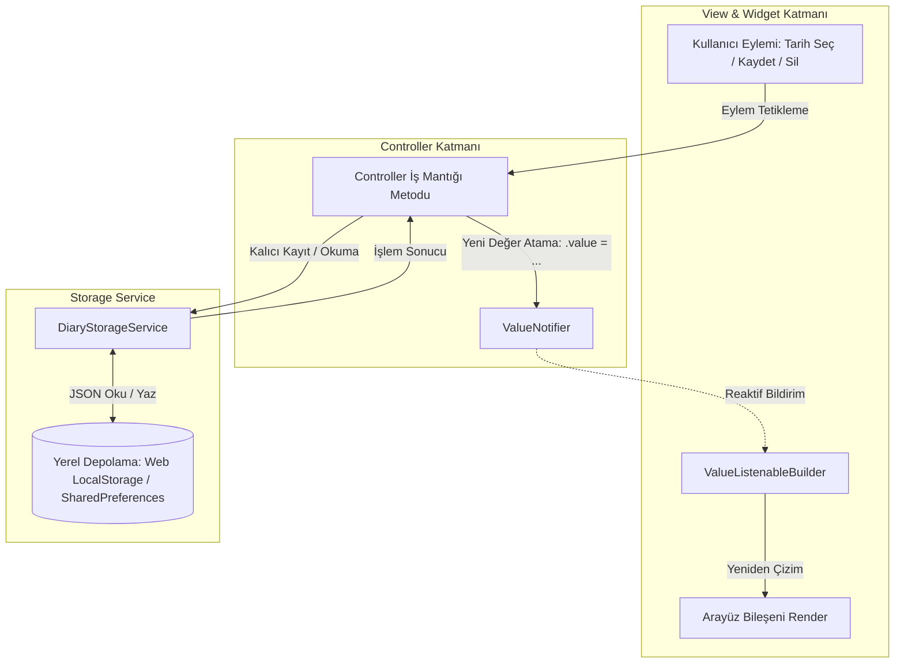
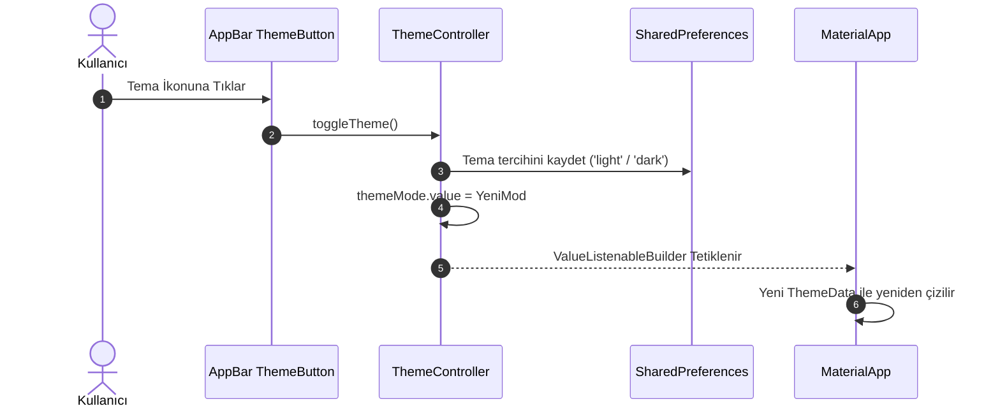

# Reaktif State Yönetimi ve Veri Akışı Kılavuzu (State Flow)

Bu doküman, **Dijital Günlüğüm** uygulamasındaki `ValueNotifier` mimarisini, veri akışını ve katmanlar arasındaki haberleşmeyi açıklamaktadır.

---

## 1. Mimari Genel Bakış (Layered Architecture)

Uygulama, sorumlulukların net olarak ayrıldığı 4 ana katmandan oluşur:

1. **Model (Data Layer):**
   - İmmutable (değiştirilemez) veri modelleri (`DiaryModel`, vb.).
   - `copyWith`, `toJson` ve `fromJson` mekanizmaları ile veri güvenliği sağlar.
2. **Storage Service (Persistence Layer):**
   - Kalıcı depolamayı (`SharedPreferences`) yönetir.
   - Verileri serialize / deserialize eder ve controller'a sunar.
3. **Controller (Business Logic Layer):**
   - `ValueNotifier` nesneleri ile uygulamanın durumunu (state) tutar.
   - UI katmanından gelen eylemleri karşılar, iş mantığını yürütür ve depolama servisini tetikler.
   - Tamamlanan işlemler sonrasında ilgili `ValueNotifier` değerlerini güncelleyerek UI'ı haberdar eder.
4. **View & Widgets (Presentation Layer):**
   - Tamamen deklaratif `StatelessWidget` yapılardır.
   - Durum güncellemelerini `ValueListenableBuilder` ile dinler ve sadece değişen alt bileşenleri yeniden çizer.

---

## 2. Mermaid Durum ve Veri Akış Diyagramı



---

## 3. Temel Kullanıcı Akışları ve State Geçişleri

### 3.1. Takvimden Tarih Seçimi Akışı
1. Kullanıcı takvimde bir güne tıklar (`CalendarDayCard.onTap`).
2. `CalendarController.selectDate(DateTime date)` metodu çağrılır.
3. `selectedDate.value` güncellenir.
4. İlgili tarihe ait günlük kaydı `DiaryController.loadDiaryForDate(date)` ile depolama servisinden sorgulanır.
5. Kullanıcı Günlük Ekranına (`DiaryView`) yönlendirilir.

### 3.2. Günlük Oluşturma ve Düzenleme Akışı
1. Kullanıcı başlık ve içerik alanlarını doldurup **Kaydet** butonuna tıklar.
2. Form doğrulama kontrol edilir (boş başlık veya içerik engellenir).
3. `DiaryController.saveOrUpdateDiary(title, content)` çağrılır.
4. Controller yeni bir `DiaryModel` oluşturur (veya mevcut modeli `copyWith` ile günceller).
5. `DiaryStorageService.saveDiary(diary)` asenkron olarak çağrılır ve JSON formatında saklanır.
6. `DiaryController.currentDiary.value` güncellenir.
7. `CalendarController.refreshMarkedDates()` tetiklenerek takvim üzerindeki işaretli günler (noktalar) yenilenir.
8. Kullanıcıya başarı mesajı (`SnackBar`) gösterilir.

### 3.3. Günlük Silme Akışı
1. Kullanıcı **Sil** butonuna tıklar.
2. Ekranda bir onay diyaloğu (`AlertDialog`) gösterilir.
3. Kullanıcı onaylarsa `DiaryController.deleteDiary(date)` çağrılır.
4. Depolama servisinden ilgili kaydın silinmesi istenir (`DiaryStorageService.deleteDiary(date)`).
5. `DiaryController.currentDiary.value = null` yapılır.
6. Takvimdeki işaretli tarihlerden silinen gün çıkartılır.
7. Kullanıcı takvim ekranına geri döner veya boş gün uyarısı gösterilir.

---

## 4. Tema Değiştirme Süreci (Theme Flow)



- `ThemeController` içerisinde `final ValueNotifier<ThemeMode> themeMode` bulunur.
- Kullanıcı temayı değiştirdiğinde `themeMode.value` atomik olarak güncellenir ve tercih yerel depolamaya yazılır.
- `main.dart` içerisindeki `ValueListenableBuilder<ThemeMode>` değişikliği dinleyerek uygulamanın renk şemasını anında günceller.

---

## 5. Controller Yaşam Döngüsü ve Kaynak Yönetimi (Dispose)

- Her `ValueNotifier` nesnesi, dinleyiciler ve bellek yönetimi için kaynak tüketir.
- Controller'lar ya singleton/bağımlılık olarak uygulama ömrü boyunca yaşar ya da bir sayfa kapandığında `dispose()` metodu çağrılarak serbest bırakılır.
- Controller içerisinde:
  ```dart
  void dispose() {
    selectedDate.dispose();
    markedDates.dispose();
  }
  ```
- Bu kural bellek sızıntılarını (memory leak) tamamen önler.
