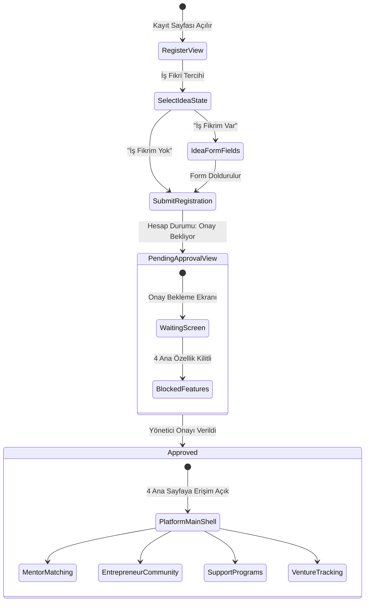

# Filizora — Kayıt, İş Fikri ve Yönetici Onay Akışı (State Flow)

Bu doküman, Filizora girişimcilik platformunda kullanıcı kayıt süreci, iş fikri tercihi ("İş fikrim var" / "İş fikrim yok") ve yönetici onayı durum yönetimini açıklar.

---

## 1. Akışın Adımları

1. **Kayıt Ekranının Açılması (`RegisterView`):**  
   Kullanıcı uygulamayı ilk açtığında ad, soyad ve e-posta bilgilerini gireceği kayıt formunu görüntüler.

2. **İş Fikri Tercihinin Belirlenmesi (`IdeaSelectionToggle`):**  
   Kullanıcıya kayıt aşamasında iki seçenek sunulur:
   - **İş Fikrim Var:** Girişimcinin hayata geçirmek veya büyütmek istediği somut bir fikri vardır.
   - **İş Fikrim Yok:** Kullanıcı ekosistemi tanımak, destekleri incelemek veya fikri olmadan topluluğa katılmak istemektedir.

3. **Koşullu İş Fikri Formu (`IdeaFormFields`):**  
   - "İş Fikrim Var" seçildiğinde iş fikrinin adı, sektörü ve kısa açıklamasının girileceği alanlar açılır.
   - "İş Fikrim Yok" seçildiğinde bu alanlar gizlenir ve doğrudan kayıt tamamlama adımına geçilir.

4. **Kaydın Tamamlanması ve Yönetici Onayı Bekleme Durumu:**  
   - Kayıt tamamlandığında kullanıcı hesabı doğrudan aktif edilmez; hesap durumu **"Yönetici Onayı Bekliyor" (`pendingApproval`)** olarak işaretlenir.

5. **Onay Bekleme Durumu ve Erişim Kısıtlaması (`PendingApprovalView`):**  
   - Onay bekleyen kullanıcıya durumunu açıklayan özel bir bekleme ekranı gösterilir.
   - Kullanıcı bu durumdayken uygulamanın ana özelliklerine (Mentorluk, Topluluk, Destekler, Süreç Takibi) **kesinlikle erişemez**.
   - Geliştirme ve test süreçlerinde akışı doğrulamak amacıyla simülasyon onay butonu yer alır; gerçek backend entegrasyonu sağlandığında bu kontrol admin paneline taşınır.

6. **Yönetici Onayı ve 4 Ana Özelliğe Erişim (`PlatformMainShell`):**  
   - Yönetici onayı tamamlandığında (`approved` durumu), kullanıcının ekranı otomatik yenilenir ve 4 ana sayfaya tam erişim sağlanır:
     1. **Mentor–Menti Eşleşmesi**
     2. **Girişimci Topluluğu**
     3. **Destek Programları**
     4. **Girişim Süreci Takibi**

---

## 2. Durum Diyagramı (Mermaid)

---

## 3. Kodlama ve Mimari Karşılığı

- **Model:** `UserAccount` ve `ApprovalStatus` enum'ı (`unauthenticated`, `pendingApproval`, `approved`, `rejected`).
- **Controller:** `AuthController`, kullanıcının kayıt verilerini, iş fikrini (`BusinessIdea`) ve onay durumunu `ValueNotifier` ile yönetir.
- **View:** `RegisterView` (Kayıt formu), `PendingApprovalView` (Onay bekleme ekranı).
- **Yönlendirme:** `AppRootRouter` (`filizora/lib/main.dart` kökünde) kullanıcının onay durumunu dinleyerek uygun ekranı dinamik olarak görüntüler.
